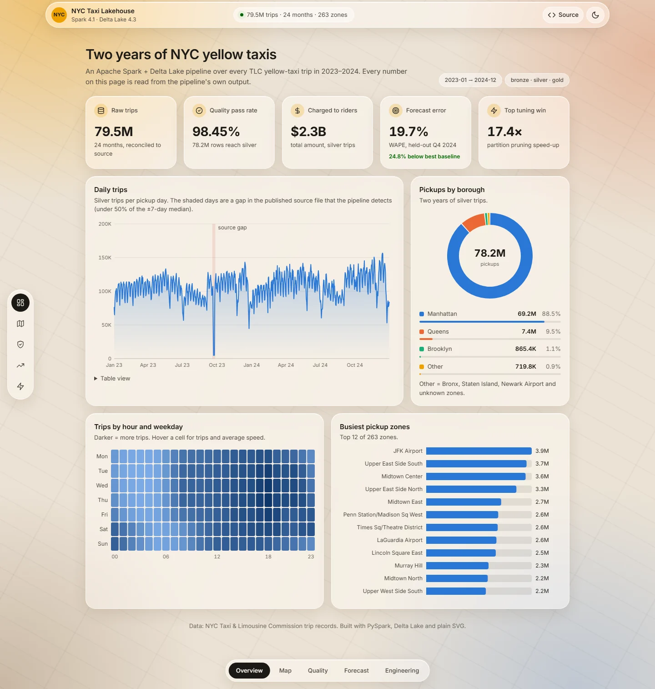
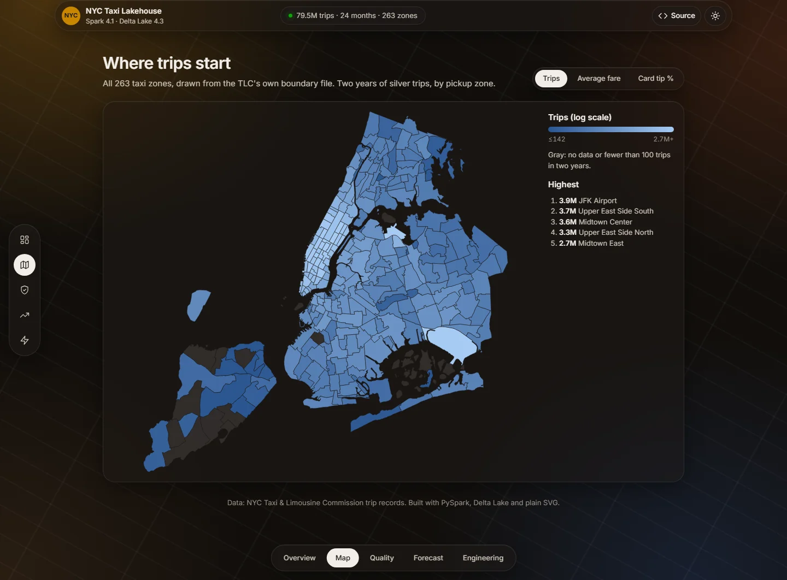
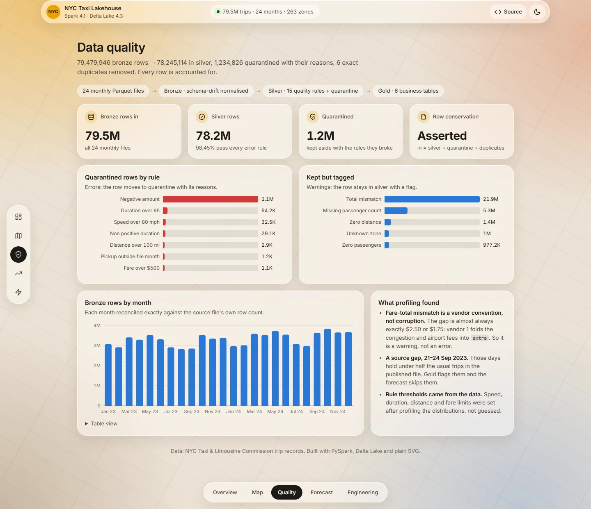
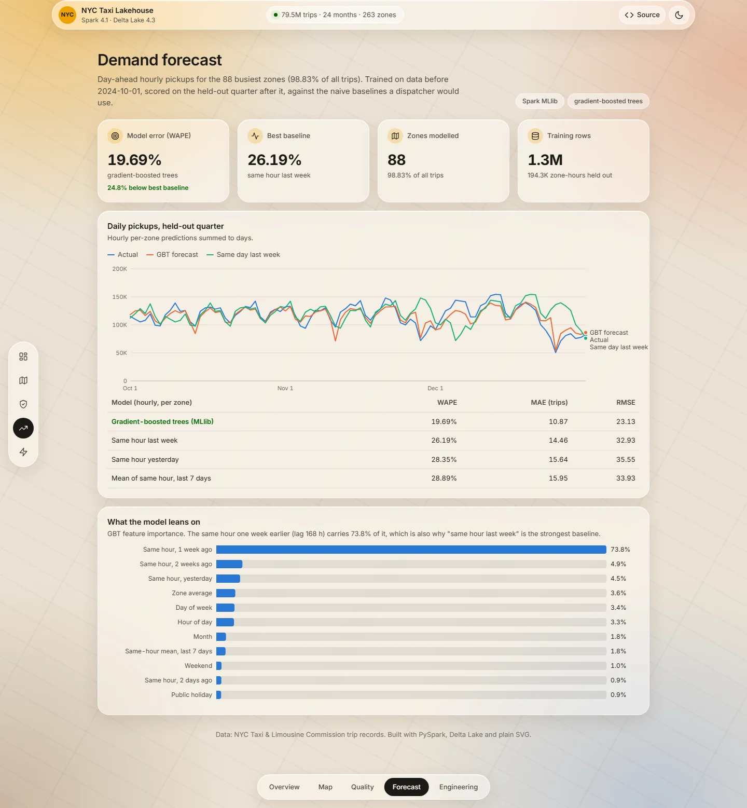
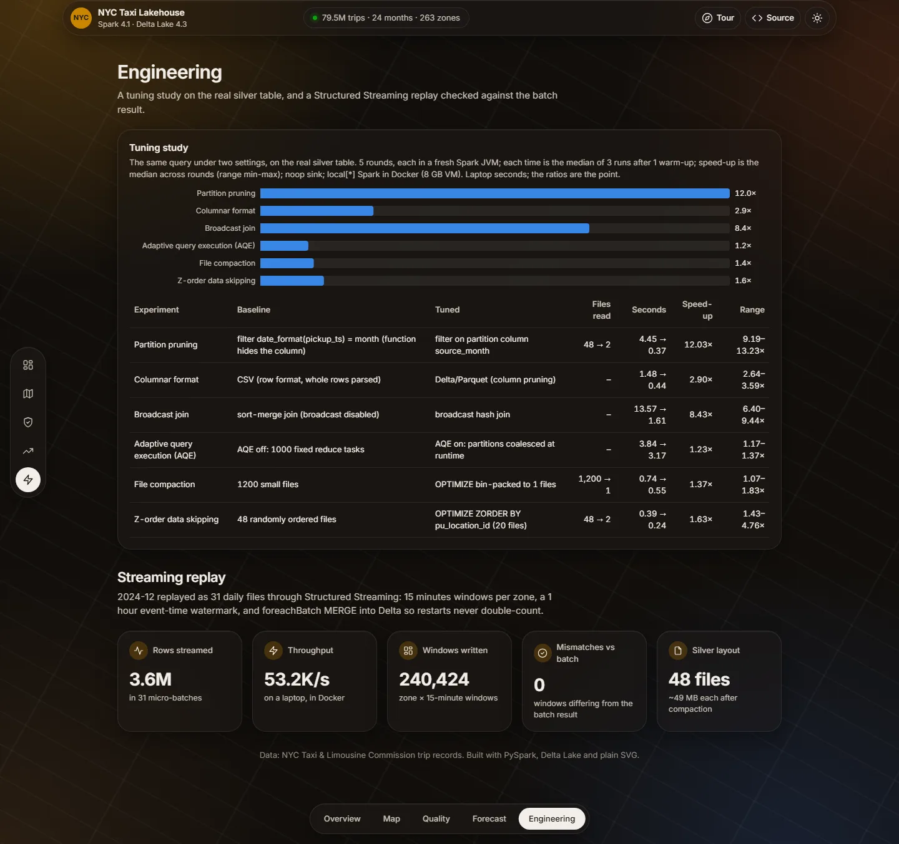
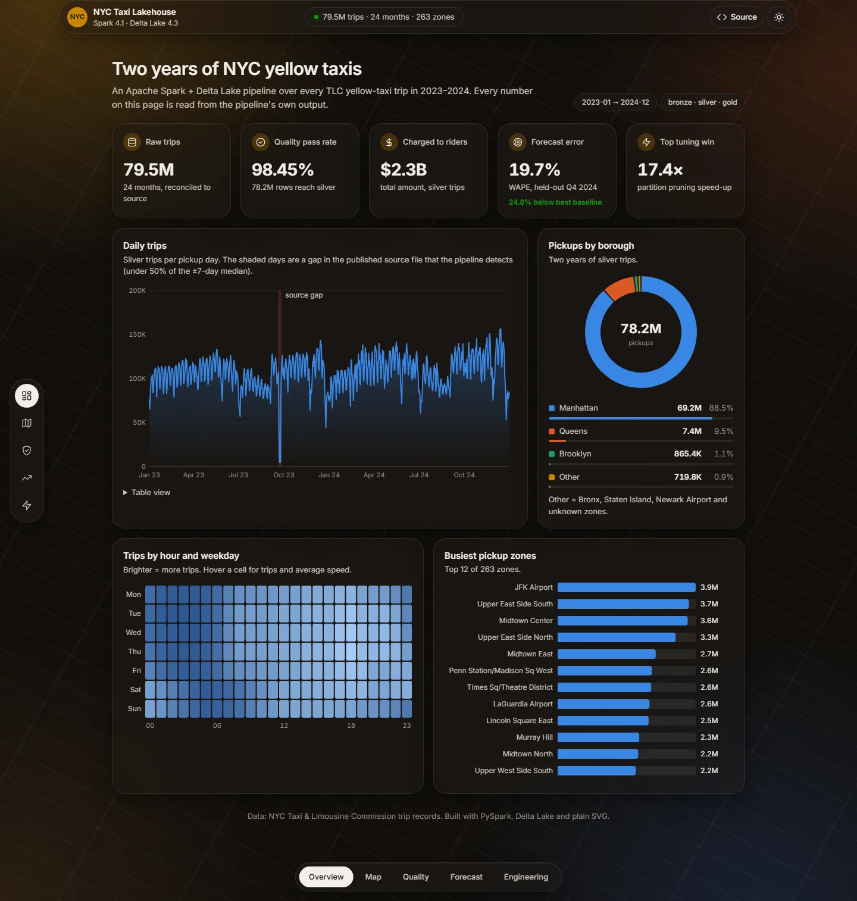
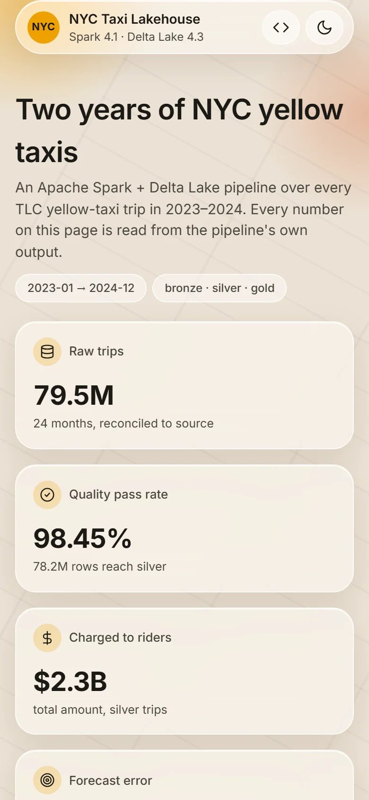

# NYC Taxi Lakehouse

[](https://github.com/neilss170/nyc-taxi-lakehouse/actions/workflows/ci.yml)

An Apache Spark 4.1 + Delta Lake pipeline over **79.5 million** NYC yellow-taxi trips (all of 2023–2024).
It runs medallion layers (bronze, silver, gold) with data-quality rules and a quarantine table,
a Structured Streaming replay (from files and from Kafka), a Spark MLlib demand forecast and a measured tuning study.
Everything runs in Docker on a laptop: one Spark container, plus a Kafka broker for the Kafka replay.

**Live dashboard:** https://neilss170.github.io/nyc-taxi-lakehouse/ (five tabs: overview, a choropleth of all 263 taxi
zones, data-quality breakdown, forecast vs actuals, and the tuning study with the streaming check; plain HTML + SVG, no framework)



<table>
  <tr>
    <td width="50%"><br><sub>Zone map: trips, average fare or card tip % per pickup zone</sub></td>
    <td width="50%"><br><sub>Data quality: every quarantined and tagged row, by rule</sub></td>
  </tr>
  <tr>
    <td width="50%"><br><sub>Forecast: GBT vs naive baselines, held-out Q4 2024</sub></td>
    <td width="50%"><br><sub>Engineering: tuning study, file and Kafka streaming replays</sub></td>
  </tr>
</table>

<details><summary>Dark theme and phone layout</summary>

 

</details>

Every number below comes from a file in [`reports/`](reports), written by the pipeline itself.

## Results

| Stage | What it does | Result |
|---|---|---|
| Bronze | Lands 24 monthly Parquet files in one Delta table, normalising schema drift | 79,479,946 rows, reconciled exactly against source file metadata |
| Silver | Dedupes, applies 15 profiled rules (10 errors, 5 warnings), quarantines failures with reasons | 78,245,114 rows pass (98.45%); 1,234,826 quarantined; 6 duplicates; every row accounted for |
| Gold | Six business tables: daily KPIs, zone × hour demand, zones, borough flows, hour × weekday, airports | All reconcile to the silver total; a gap in the published source data is detected automatically |
| Streaming | Replays Dec 2024 day by day: 15-min zone windows, 1 h watermark, `foreachBatch` MERGE | 3,585,099 rows in 31 micro-batches (~53k rows/s); all 240,424 windows match the batch result |
| Kafka | Publishes Dec 2024 to a 3-partition topic keyed by zone; Spark consumes it in two runs, the second a restart from checkpointed offsets | 3,585,099 messages, each consumed once across the restart (~41k rows/s); 0 dropped by the watermark; all 240,424 windows match the batch result |
| Forecast | Day-ahead hourly pickups for the 88 busiest zones (98.8% of trips), GBT vs naive baselines | Held-out Q4 2024 WAPE **19.7%** vs 26.2% for the best baseline (**24.8% lower error**) |
| Tuning | Six before/after experiments on the real silver table | Median of 5 rounds: partition pruning **12×**, broadcast join **8.4×**, Parquet vs CSV **2.9×** |

## What the data actually looked like

Profiling the raw data changed the design. These are the findings worth knowing:

- **Schema drift.** January 2023 stores IDs as `int64` and `passenger_count` as `double`, and calls a column
  `airport_fee`. Every later month uses `int32`/`int64` and calls it `Airport_fee`. Bronze maps both onto one
  canonical schema, matching column names case-insensitively, and a test covers both variants.
- **The 27.7% "bad totals" weren't bad.** In 22M rows the fare components don't sum to `total_amount`. The gap is
  almost always exactly **$2.50** (congestion surcharge) or **$1.75** (airport fee), and 83% of those rows come from vendor 1.
  That vendor folds those fees into `extra`, so this is a reporting convention. It's tagged as a warning, not rejected.
- **Flex Fare rows.** 5.4M trips have `payment_type = 0` with null passenger count and rate code. They are real trips,
  so they stay in silver with a warning tag.
- **A hole in the published data.** Partway through 21 September 2023 the source file drops from roughly 100k trips a
  day to 41k, then to 4.6–5.7k a day through the 24th. Both vendors' metered trips are missing and only Flex Fare rows remain. Bronze matches the source file
  exactly, so the gap is upstream. Gold flags any day below 50% of its ±7-day median, and that check finds exactly these
  four days. The forecast then excludes every row whose target *or lag features* touch them.
- **Small files.** See the tuning study below: silver was first 4,800 files averaging 0.59 MB.
- **Memory.** The first silver version deduplicated and cached all 79.5M rows in one batch, and it ran out of memory
  on a 5 GB heap. Processing one month per batch keeps memory flat no matter how much history there is.

## Tuning study

Each experiment times the same query under two settings on the real silver table: the median of 3 runs after a
warm-up, run end to end with Spark's `noop` sink. One round of that turned out to be noisy (a from-scratch rerun moved
some speed-ups by half), so the study runs **5 rounds, each in a fresh Spark JVM**, and reports the median speed-up with
its min–max range. Every round is kept in [`reports/benchmark_rounds/`](reports/benchmark_rounds/). Where Delta's file
statistics explain the result, the file count is shown too; for Z-order it is read straight from the Delta log's
per-file min/max stats.

| Experiment | Baseline → tuned | Files read | Median seconds | Speed-up (median) | Range over 5 rounds |
|---|---|---|---|---|---|
| Partition pruning (Dec 2024 out of 24 months) | `date_format(pickup_ts)` filter → filter on partition column | 48 → 2 | 4.45 → 0.37 | **12.0×** | 9.2–13.2× |
| Broadcast join (78M trips × 265 zones) | sort-merge join → broadcast hash join | | 13.57 → 1.61 | **8.4×** | 6.4–9.4× |
| Columnar format (one month, 2 of 30 columns) | CSV → Delta/Parquet | | 1.48 → 0.44 | **2.9×** | 2.6–3.6× |
| Z-order data skipping (JFK only, 6 months) | random layout → `OPTIMIZE ZORDER BY pu_location_id` | 48 → 2 of 20 could match | 0.39 → 0.24 | 1.6× | 1.4–4.8× |
| File compaction (6 months) | 1,200 small files → `OPTIMIZE` | 1,200 → 1 | 0.74 → 0.55 | 1.4× | 1.1–1.8× |
| Adaptive query execution (1,000 shuffle partitions) | AQE off → on | | 3.84 → 3.17 | 1.2× | 1.2–1.4× |

What to read from this:
- **Wrapping a column in a function is the costly mistake.** Filtering on `pickup_date` directly would still be fast,
  because Delta skips files using min/max stats. `date_format(pickup_ts, ...)` hides the column from both partition
  pruning and those stats.
- **The CSV copy of one month is 746 MB; the Delta/Parquet copy is 109 MB.**
- **AQE gives a small but steady gain** (1.2–1.4× in every round). The aggregate's output is small, so 1,000 tiny
  reduce tasks cost little to begin with.
- **Z-order and compaction save little time here** because both queries are already sub-second on a laptop, and their
  ranges are the widest. The skipped files (18 of 20 for Z-order) are the part that scales.
- **The single-run numbers this table replaces were optimistic** (partition pruning 17.4×, compaction 2.3×). Re-running
  is what showed it.

The small-file problem was real in this project too. Silver was first written straight out of a 200-partition shuffle:
**4,800 files averaging 0.59 MB**. Writing each month as 2 files gives **48 files of about 49 MB**. Each month's write now
runs on 2 tasks instead of 200, so the silver build got slower (735 s → 921 s); every read downstream gets the benefit.

## Forecast

The forecast is a day-ahead model of hourly pickups per zone. Every feature is at least 24 hours old, the zone × hour grid is
zero-filled, the zone-level mean is fit on training rows only, and the split is by time (train before 2024-10-01).

| Model | WAPE | MAE (trips/h) | RMSE |
|---|---|---|---|
| **Gradient-boosted trees (MLlib)** | **19.69%** | **10.87** | **23.13** |
| Same hour last week | 26.19% | 14.46 | 32.93 |
| Same hour yesterday | 28.35% | 15.64 | 35.55 |
| Mean of same hour, last 7 days | 28.89% | 15.95 | 33.93 |

`lag_168` (same hour last week) carries 74% of the feature importance, because weekly seasonality dominates taxi demand.

## Run it

You need Docker. The data (1.3 GB download, about 5.3 GB once all layers are built) lives in a Docker volume.

```bash
docker compose build
docker compose run --rm spark python -m lakehouse all        # download -> bronze -> ... -> benchmark
docker compose run --rm spark python -m pytest               # tests
python -m http.server -d site 8000                           # dashboard (after: cp -r reports site/reports)

docker compose --profile kafka up -d --wait kafka            # single-node Kafka (KRaft), only for the kafka stage
docker compose run --rm spark python -m lakehouse kafka      # also lets the Kafka tests run instead of skipping
```

You can run stages one at a time (`python -m lakehouse silver gold`). Each stage overwrites only the
months it processes, so re-running a stage is safe. Set `LAKEHOUSE_START` / `LAKEHOUSE_END` (YYYY-MM)
to change the date range, and `SPARK_DRIVER_MEMORY` to change the heap size (default 5g).

## Layout

```
src/lakehouse/
  download.py    TLC files + SHA-256 manifest, retries, size check
  bronze.py      canonical schema, replaceWhere per month, source reconciliation
  quality.py     declarative error / warning rules
  silver.py      dedupe, tag, split to silver / quarantine, row conservation check
  gold.py        business tables, source-gap flag, dashboard extracts
  zonemap.py     TLC zone shapefile -> simplified SVG paths for the dashboard map
  streaming.py   file-stream replay, watermark, foreachBatch MERGE, batch parity check
  kafka_stream.py Kafka producer + consumer replay with a restart, offset and batch parity checks
  forecast.py    dense grid, leakage-safe features, GBT vs baselines
  benchmark.py   before/after timing harness, Delta log file-stats reader
  vacuum.py      removes data files no retained Delta version references
tests/           runs on a local Spark session in Docker and on GitHub Actions
reports/         JSON output of every stage (the source of every number here)
site/            static dashboard (GitHub Pages)
```

## Limits

- Single-node `local[*]` Spark in an 8 GB Docker VM. The timings are laptop numbers; the ratios are what matter.
- Kafka is a single broker with replication factor 1, and the producer is a Spark batch write rather than a live feed.
  Ordering holds per partition only, so the consumer caps each micro-batch (120,000 offsets) to keep partitions close in
  event time; the report counts rows dropped by the watermark in case they drift apart (0 in this run).
- The forecast has no weather or event data, which is the obvious next feature set.

Data: [NYC Taxi & Limousine Commission trip records](https://www.nyc.gov/site/tlc/about/tlc-trip-record-data.page).
